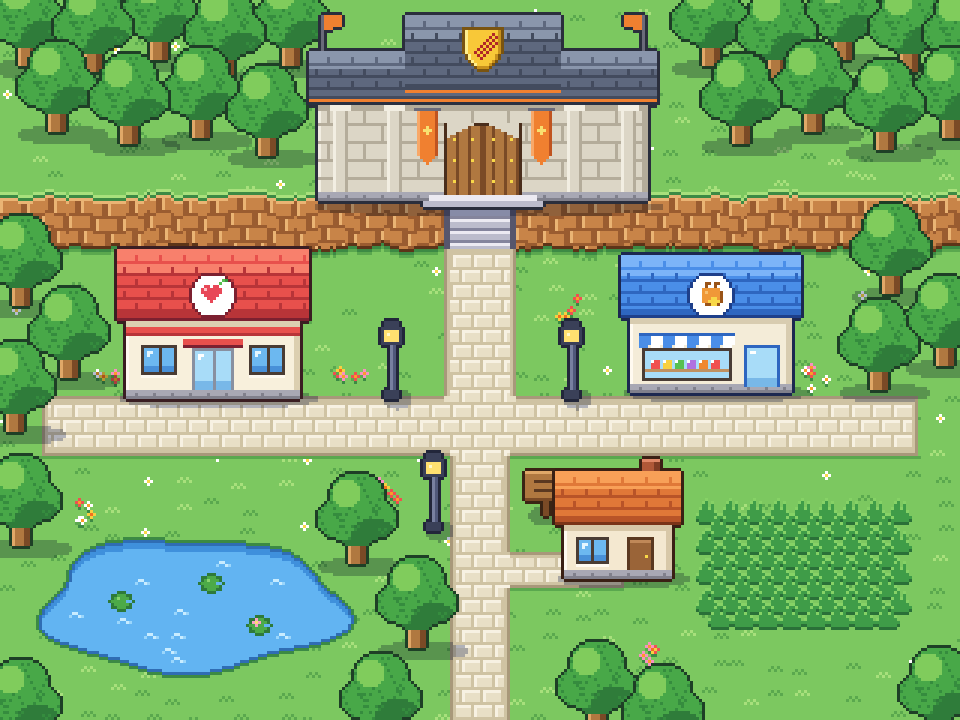
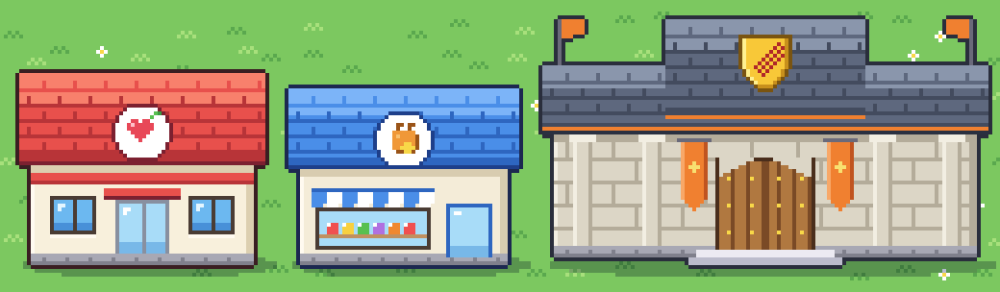

# Guia de estilo da cidade

As regras que toda arte de construção e de decoração de cidade segue, desenhada por código ou por outra ferramenta. Nasceu da amostra aprovada pelo dono em 2026-11-12 ([README](README.md)). O terreno, a água, as árvores, as pedras e a vegetação não seguem este guia: eles continuam no estilo deles.

Ao criar arte nova de cidade, siga estas regras. Para mudar uma, mude aqui primeiro, com o motivo.

A amostra aprovada, ampliada 3x e 4x (as construções dela ainda estão no tamanho da amostra, menores que no jogo):

## A ideia em uma frase

Pixel art de RPG de criaturas, vista de frente e um pouco de cima, com cores vivas, contorno escuro na cor do próprio objeto e luz vindo de cima à esquerda. Cada construção importante tem uma cor e um símbolo só dela, para ser reconhecida de longe.

## O que nunca fazer

- Copiar qualquer coisa do Pokémon: a esfera vermelha e branca, o prédio do centro de cura, a loja de teto azul com o letreiro deles, os ginásios, os nomes. Vale o gênero, não o jogo.
- Usar a cruz vermelha (é símbolo protegido). O símbolo de cura do Ecobeast é o coração com a folha.
- Escrever palavras nas placas e fachadas. Os símbolos falam por elas, e o jogo é traduzível.
- Usar degradê suave, borrado, anti-serrilhado ou meio pixel. Todo pixel é de uma cor da paleta, opaco, menos a sombra no chão.
- Usar preto puro (`#000000`) no contorno.

## Escala

- A arte fica em 1x, na escala do mapa: o hexágono tem 64 px de largura, as linhas de hexágonos ficam a 42 px uma da outra, e o Domador tem 25 px de altura.
- A porta tem de 14 a 20 px de altura e de 10 a 14 px de largura: o Domador "cabe" nela.
- Uma janela tem de 8 a 10 px de largura e de 7 a 9 px de altura.
- A largura da arte cabe no formato do objeto, com uns 4 px de folga de cada lado: 1 hexágono até 56 px, 2 ou 3 hexágonos até 120 px, 5 hexágonos até 184 px.
- O pé da arte fica no ponto de apoio do formato, como manda o [architecture.md da island-villages](../island-villages/architecture.md#o-desenho-no-jogo).

## Luz, contorno e sombra

- **Luz de cima à esquerda.** A borda de cima e a da esquerda de cada peça são um tom mais claras; a borda da direita (2 px) e a de baixo são um tom mais escuras.
- **Contorno de 1 px por fora**, em volta de toda a silhueta do objeto, na cor mais escura do material principal dele (a coluna "contorno" das paletas). As linhas de dentro (divisões do telhado, batentes, tábuas) usam o tom escuro do próprio material.
- **Sombra no chão:** uma oval embaixo do pé do objeto, da largura dele, com uns 7 px de altura, preta com 18% de opacidade (a `SHADOW` dos geradores). É o único pixel semitransparente da arte, e por isso o toque não a conta (`HIT_ALPHA` é 0,5).
- **Sombra do beiral:** as 2 primeiras linhas da parede, logo abaixo do telhado, são do tom escuro da parede.

## Paletas

Cada material tem 4 tons: claro, base, escuro e contorno. Um objeto usa só as cores destas paletas e as de [Detalhes](#detalhes); para um material novo, crie a paleta aqui primeiro, no mesmo formato.

### Telhados

| Telhado | Claro | Base | Escuro | Contorno | De quem |
| --- | --- | --- | --- | --- | --- |
| Vermelho | `#f8806c` | `#e8504c` | `#b83438` | `#7c2030` | **só do Refúgio** |
| Azul | `#7cb4f8` | `#4a8ee8` | `#2e66c0` | `#1e3f8a` | **só da Loja** |
| Ardósia | `#8a96ac` | `#5e687e` | `#434b5e` | `#2a3040` | **só da Arena**, com a faixa laranja |
| Laranja | `#f8a058` | `#e07838` | `#b85428` | `#7a3418` | casas |
| Marrom | `#c89870` | `#a0704c` | `#785034` | `#4c3020` | casas |
| Verde | `#8cd07c` | `#58a858` | `#3c7c44` | `#24502c` | casas |
| Roxo | `#b490e0` | `#8a64c0` | `#644496` | `#402a64` | casas |
| Turquesa | `#78d0c8` | `#40a8a0` | `#2c7c78` | `#1c504e` | casas |
| Mostarda | `#f0d070` | `#d0a840` | `#a07c28` | `#64481a` | casas |

### Paredes e materiais

| Material | Claro | Base | Escuro | Contorno |
| --- | --- | --- | --- | --- |
| Reboco creme | `#fffaf0` | `#f4ecd8` | `#d8ccb0` | `#5a4a3a` |
| Pedra da Arena | `#f2eee2` | `#dcd6c6` | `#b4ac9a` | `#2a2e3c` |
| Pedra cinza (base, escada) | `#eceaf2` | `#bcbccc` | `#84849c` | `#56566c` |
| Madeira | `#e0a868` | `#b07840` | `#7a4a26` | `#3a2414` |
| Ferro (poste, grade) | `#7880a0` | `#50587a` | `#3a4058` | `#22263a` |
| Tijolo (chaminé) | `#e08868` | `#b05838` | `#803c24` | `#4c2014` |
| Palha | `#f0ce7e` | `#d6aa5c` | `#a87c3c` | `#5c4020` |
| Terra de canteiro | `#c08858` | `#9a6838` | `#74482a` | `#4a2c18` |

### Detalhes

| Detalhe | Cores |
| --- | --- |
| Vidro | `#6cb8f0` base, `#4890d8` as 2 linhas de baixo, `#e4f6ff` o brilho de 3 px no canto de cima à esquerda; vidro de porta `#a8dcf8` com `#78b8e8` embaixo |
| Batente e moldura | `#4a3c34`; parapeito de 1 px `#fffaf0` embaixo da janela |
| Fundação | 3 linhas `#a8a8b4`, a de baixo `#80808c`, com uma junta `#80808c` a cada 6 px |
| Laranja das bandeiras | `#f8a868` claro, `#f08030` base, `#c05420` escuro |
| Ouro | `#fff090` claro, `#f8c838` base, `#c8901c` escuro, `#7a5410` contorno |
| Luz de lâmpada | `#ffe070`, brilho `#fff8c8` |
| Flores | `#f05050`, `#f8d040`, `#ffffff`, `#f890c0`, miolo `#f8a028` |
| Folhagem de canteiro | `#86d266` claro, `#3f9c48` base, `#2a7038` escuro |

## Formas

- **Telhado:** visto de frente, ocupa de 40% a 50% da altura da construção e passa 3 px da parede de cada lado. O primeiro terço é do tom claro, o meio é base, e as 3 últimas linhas são escuras, com a última no tom de contorno (o beiral). Há uma linha de telha a cada 4 px, do tom de baixo dela, com uma emenda de 2 px a cada 8 px, desencontrada entre as linhas.
- **Parede:** reboco, com a luz e a sombra de [Luz, contorno e sombra](#luz-contorno-e-sombra) e a fundação embaixo.
- **Janela:** vidro com moldura, um montante no meio e o parapeito.
- **Chaminé, beiral, toldo, bandeira:** peças pequenas que dão personalidade. Cada construção tem pelo menos uma.

## As construções-chave

Cada uma tem uma cor reservada e um **emblema**: um disco branco de raio 10 px com o anel de 1 px do tom de contorno do telhado, no meio da frente do telhado, com o símbolo dentro.

| Construção | Telhado | Emblema | Detalhes que a fazem reconhecível |
| --- | --- | --- | --- |
| Refúgio | vermelho | coração `#e84858`, brilho `#ffc0c8`, com uma folha verde `#58c050` | faixa vermelha na parede, logo abaixo do beiral; porta dupla de vidro com marquise vermelha; janelas dos dois lados |
| Loja | azul | sacola laranja `#f09838` com moeda de ouro | toldo listrado azul e branco sobre a vitrine, com produtos coloridos na prateleira; porta de vidro de moldura azul |
| Arena | ardósia, com faixa laranja no beiral | escudo de ouro com três marcas de garra `#b02828` (sem o disco) | prédio de pedra largo, com o telhado do meio mais alto; colunas; portão de madeira em arco com rebites de ouro; estandartes laranja; bandeiras laranja nos cantos; escada de pedra na frente |

As casas comuns não usam vermelho, azul nem ardósia no telhado, nem emblema, nem símbolo.

## Animação

- Só o que se mexe de verdade é animado: as pás do moinho, o brilho do santuário.
- Os quadros ficam lado a lado no PNG, com a mesma largura e o pé no mesmo lugar ([island-villages](../island-villages/architecture.md#os-tipos-de-objeto)).

## Conferir uma arte nova

1. Ampliada 4x, ao lado da amostra aprovada: o traço é o mesmo?
2. No mapa, ao lado do Domador: a porta cabe nele, e a construção não engole o hexágono de trás mais do que precisa?
3. De longe (a imagem reduzida à metade): dá para saber o que ela é?
4. Todas as cores estão nas paletas?
